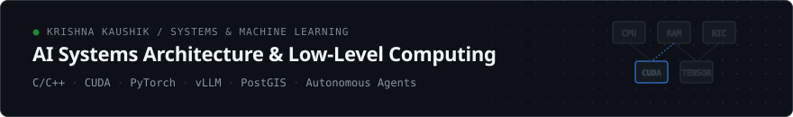

  <picture>
    <source media="(prefers-color-scheme: dark)" srcset="./assets/banner-dark.svg">
    <source media="(prefers-color-scheme: light)" srcset="./assets/banner-light.svg">
    
  </picture>

### Hey, I'm Krishna.

I'm an AI systems engineer and undergraduate at Shoolini University, working at the convergence of low-level systems and modern AI architectures. My work bridges bare-metal computational efficiency (C/C++, CUDA, memory locality) with scalable distributed intelligence (high-throughput inference, spatial intelligence, and agentic systems).

---

### Selected Systems

- **[CivicLens](https://github.com/krishnakaushik1322007-ai/CivicLens)** `[FastAPI · PostGIS 3.6 · Next.js 16 · Gemini]`  
  Autonomous municipal spatial intelligence platform. Uses `ST_DWithin` geospatial clustering to consolidate duplicate citizen reports by 40.4%, paired with Gemini 2.5 Flash for vision triage and a deterministic 6-factor priority engine.

- **[Agentic-RAG-Engine](https://github.com/krishnakaushik1322007-ai/Agentic-RAG-Engine)** `[Python · FastAPI · Hybrid Search · Docker]`  
  Self-reflective retrieval system designed to eliminate hallucination loops. Implements semantic intent classification, dynamic query routing, dense/sparse hybrid search, and cross-encoder verification.

- **[CampusOS AI](https://github.com/krishnakaushik1322007-ai/campus-OS-AI)** `[Next.js 16 · TypeScript · Supabase RLS]`  
  Multi-tenant university operating platform with granular student, faculty, and administrator RBAC enforced via 14 PostgreSQL Row-Level Security policies and a contextual campus copilot.

- **[ZENETH](https://github.com/krishnakaushik1322007-ai/Cpp-Project-build-2nd-Sem)** `[C++ · STL · Knowledge Systems]`  
  Deterministic rule-based expert diagnostic system for multi-crop pathology. Uses symptom decision trees and keyword resolution to provide targeted remediation protocols without external runtime dependencies.

---

### Technical Surface

| Domain | Core Tooling & Technologies |
| :--- | :--- |
| **Systems & Languages** | C, C++, CUDA, Python, TypeScript, SQL, Bash |
| **Inference & Deep Learning** | PyTorch, vLLM, TensorRT-LLM, FlashAttention, QLoRA, Agentic RAG |
| **Spatial & Vector Data** | PostgreSQL, PostGIS 3.6, pgvector, Qdrant, ChromaDB, Supabase |
| **Web & Runtime** | Next.js, FastAPI, Node.js, Docker, Linux, Git |

---

### Current Explorations

- **Inference Latency**: Profiling KV-cache reuse, continuous batching, and speculative decoding with vLLM under high concurrency.
- **Geospatial Indexing**: Analyzing performance trade-offs of `GIST` vs `SP-GIST` index structures on large municipal polygon and point datasets.
- **Low-Level Kernels**: Writing and profiling custom CUDA kernels for fused tensor operations and memory-efficient matrix multiplication.

---

### Activity

  <picture>
    <source media="(prefers-color-scheme: dark)" srcset="https://raw.githubusercontent.com/krishnakaushik1322007-ai/krishnakaushik1322007-ai/output/github-contribution-grid-snake-dark.svg">
    <source media="(prefers-color-scheme: light)" srcset="https://raw.githubusercontent.com/krishnakaushik1322007-ai/krishnakaushik1322007-ai/output/github-contribution-grid-snake.svg">
    
  </picture>

---

  <a href="mailto:krishnakaushik1322007@gmail.com">Email</a> &nbsp;·&nbsp;
  <a href="https://linkedin.com">LinkedIn</a> &nbsp;·&nbsp;
  <a href="https://twitter.com">X / Twitter</a> &nbsp;·&nbsp;
  <a href="https://huggingface.co/krishnakaushik1322007-ai">Hugging Face</a> &nbsp;·&nbsp;
  <a href="https://kaggle.com">Kaggle</a>

