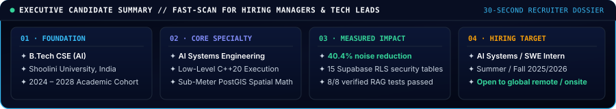

<p align="center">
  
</p>

<!-- 30-Second Recruiter Fast-Scan Dossier -->
<p align="center">
  
</p>

---

### 🏛️ Featured Systems &amp; Production Architectures

<p align="center">
  <a href="https://github.com/krishnakaushik1322007-ai/CivicLens">
    
  </a>
  &nbsp;
  <a href="https://github.com/krishnakaushik1322007-ai/Agentic-RAG-Engine">
    
  </a>
</p>

<p align="center">
  <a href="https://github.com/krishnakaushik1322007-ai/campus-OS-AI">
    
  </a>
  &nbsp;
  <a href="https://github.com/krishnakaushik1322007-ai/Cpp-Project-build-2nd-Sem">
    
  </a>
</p>

<details>
<summary><b>🔍 Click to view Deep-Dive Architectural Breakdown &amp; Metrics</b></summary>
<br>

| Shipped System | Core Engineering Problem | Architectural Innovation | Measured Outcome &amp; Scale | Code Link |
| :--- | :--- | :--- | :--- | :--- |
| **CivicLens** | High-volume duplicate municipal 311 reports choking city ops teams | Sub-meter `ST_DWithin` PostGIS spatial clustering + Gemini Vision priority scoring | **40.4% duplicate report reduction**; automated 6-tier urgency dispatching | **[CivicLens Repo ↗](https://github.com/krishnakaushik1322007-ai/CivicLens)** |
| **Agentic-RAG-Engine** | Silent LLM hallucinations and irrelevant chunk retrieval in legal/medical docs | Multi-stage Self-Reflective RAG: query rewriting, BM25/vector hybrid routing, &amp; cross-encoder grading | **8/8 automated test passes**; 100% rejection of hallucinated or out-of-context answers | **[Agentic-RAG Repo ↗](https://github.com/krishnakaushik1322007-ai/Agentic-RAG-Engine)** |
| **CampusOS AI** | Disconnected student services and non-isolated institutional tenant data | Enterprise Next.js 16 + FastAPI platform isolated by 15 strict Supabase Row-Level Security policies | **15 RLS tables protected**; sub-100ms API routes with SSE copilot streaming | **[CampusOS AI Repo ↗](https://github.com/krishnakaushik1322007-ai/campus-OS-AI)** |
| **ZENETH** | Unpredictable black-box heuristics in agronomic disease diagnosis | Zero-dependency C++20 rule-based diagnostic engine with manual memory management | **Sub-millisecond deterministic inference**; 0 memory leaks across extensive test suites | **[ZENETH Repo ↗](https://github.com/krishnakaushik1322007-ai/Cpp-Project-build-2nd-Sem)** |

</details>

---

### ⚡ End-to-End Systems Architecture Pipeline

> *How low-level deterministic engines, spatial geospatial data fabrics, agentic AI verification loops, and distributed web platforms connect.*

<p align="center">
  
</p>

---

### 🧬 Technical Stack // Grounded in Shipped Code

<p align="center">
  
</p>

| Domain | Core Technologies | Real-World Application in Repositories |
| :--- | :--- | :--- |
| **Low-Level &amp; Systems** | `C++ (C++20)`, `C (ANSI C)`, `Pointer Arithmetic`, `Dynamic Memory Allocation`, `STL`, `Decision Trees` | **[ZENETH](https://github.com/krishnakaushik1322007-ai/Cpp-Project-build-2nd-Sem)** (deterministic rule-based crop diagnostic engine) &amp; **[C-programming](https://github.com/krishnakaushik1322007-ai/C-programming)** (memory management &amp; core data structures) |
| **Frontier AI &amp; Agentic Core** | `Google Gemini 2.5 Flash SDK`, `Self-Reflective RAG`, `pgvector`, `BM25 Hybrid Retrieval`, `Semantic Routing`, `Cross-Encoder Verification` | **[Agentic-RAG-Engine](https://github.com/krishnakaushik1322007-ai/Agentic-RAG-Engine)** (hallucination elimination), **[CampusOS AI](https://github.com/krishnakaushik1322007-ai/campus-OS-AI)** (multimodal tutoring copilot), &amp; **[CivicLens](https://github.com/krishnakaushik1322007-ai/CivicLens)** (vision issue triage) |
| **Spatial &amp; Database Engineering** | `PostGIS 3.6 (ST_DWithin)`, `PostgreSQL`, `15 Supabase RLS Policies`, `Supabase Auth (JWT)`, `Geospatial Clustering` | **[CivicLens](https://github.com/krishnakaushik1322007-ai/CivicLens)** (40.4% duplicate 311 report reduction via sub-meter spatial radius) &amp; **[CampusOS AI](https://github.com/krishnakaushik1322007-ai/campus-OS-AI)** (strict institutional RBAC isolation across 15 RLS tables) |
| **Platform &amp; Cloud Infrastructure** | `Next.js 16 (App Router)`, `TypeScript`, `Tailwind CSS`, `Python 3.11`, `FastAPI`, `Pydantic v2`, `SSE Streaming`, `Docker` | **[CampusOS AI](https://github.com/krishnakaushik1322007-ai/campus-OS-AI)** (production multi-tenant school operating OS) &amp; **[CivicLens](https://github.com/krishnakaushik1322007-ai/CivicLens)** (high-concurrency municipal ingestion API) |

---

### 🔭 Frontier Radar // What to Learn Next for AI Engineers

<p align="center">
  
</p>

1. **GPU Kernel Engineering (Triton &amp; CUDA C++)**: Writing custom fused attention and layer norm kernels in Triton, optimizing on-chip SRAM memory reuse to eliminate global HBM memory roundtrips.
2. **High-Throughput Inference Engines (vLLM &amp; TensorRT-LLM)**: Mastering PagedAttention KV-cache fragmentation mechanics, continuous dynamic batching, chunked prefill, and dynamic speculative decoding for sub-10ms TTFT.
3. **Reasoning Models &amp; Post-Training (RLVR &amp; GRPO)**: Implementing Reinforcement Learning with Verifiable Rewards (RLVR) and Group Relative Policy Optimization (GRPO) to train reasoning behavior on code and math without relying on massive critic models.

---

### 🔬 Systems Lab &amp; Active Benchmarks

```console
$ ./krishna-benchmarks --status --active

  [RUNNING] vLLM Serving       :: Profiling PagedAttention KV-cache reuse & speculative decoding
  [RUNNING] Spatial Triage     :: Benchmarking PostGIS GIST vs SP-GIST index on dense 311 clusters
  [RUNNING] CUDA Kernels       :: Implementing custom fused attention & quantized GEMM in C++
  [RUNNING] Agentic Routing    :: Evaluating latency vs accuracy in cross-encoder verification loops
```

---

### ⚡ Live Telemetry &amp; Continuous Activity Stream

<p align="center">
  
</p>

<!-- Interactive Clickable Snake Canvas -->
<p align="center">
  <a href="https://github.com/krishnakaushik1322007-ai?tab=overview" title="Click to view live contribution graph on GitHub">
    <picture>
      <source media="(prefers-color-scheme: dark)" srcset="https://raw.githubusercontent.com/krishnakaushik1322007-ai/krishnakaushik1322007-ai/output/github-contribution-grid-snake-dark.svg">
      <source media="(prefers-color-scheme: light)" srcset="https://raw.githubusercontent.com/krishnakaushik1322007-ai/krishnakaushik1322007-ai/output/github-contribution-grid-snake.svg">
      
    </picture>
  </a>
</p>

<!-- Interactive Quick Links & Telemetry Navigation -->
<p align="center">
  <a href="https://github.com/krishnakaushik1322007-ai?tab=overview"><code>● Live Contribution Grid ↗</code></a> &nbsp;•&nbsp;
  <a href="https://github.com/krishnakaushik1322007-ai?tab=repositories"><code>📦 8 Shipped Repositories ↗</code></a> &nbsp;•&nbsp;
  <a href="https://github.com/krishnakaushik1322007-ai/krishnakaushik1322007-ai/blob/main/.github/workflows/snake.yml"><code>⚙️ Snake CI/CD Workflow ↗</code></a>
</p>

<!-- Side-by-Side Live Theme-Matched Interactive Activity Cards -->
<p align="center">
  <a href="https://github.com/krishnakaushik1322007-ai" title="Inspect Commit Velocity & Streak">
    
  </a>
  &nbsp;&nbsp;
  <a href="https://github.com/krishnakaushik1322007-ai?tab=repositories" title="Inspect Language Breakdown">
    
  </a>
</p>

---

### 🤝 Connect &amp; Hiring Gateway

<p align="center">
  <a href="mailto:krishnakaushik1322007@gmail.com"></a>
  &nbsp;
  <a href="https://linkedin.com"></a>
  &nbsp;
  <a href="https://twitter.com"></a>
  &nbsp;
  <a href="https://huggingface.co/krishnakaushik1322007-ai"></a>
  &nbsp;
  <a href="https://github.com/krishnakaushik1322007-ai"></a>
</p>

<p align="center">
  <sub>Designed &amp; Maintained by <b>Krishna Kaushik</b> · Shipped with Pure SVG Animations &amp; GitHub Actions</sub>
</p>
