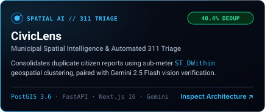
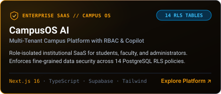
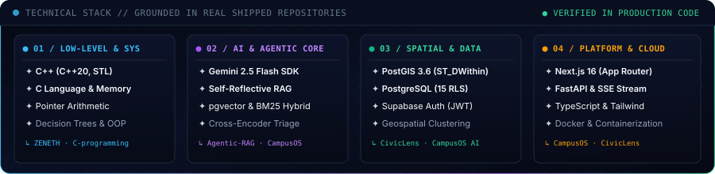
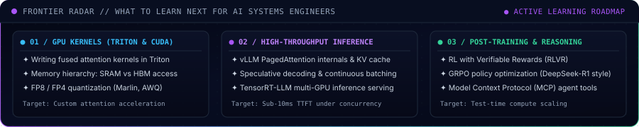

<p align="center">
  
</p>

<p align="center">
  <code>📍 Himachal Pradesh, India</code> &nbsp;•&nbsp;
  <code>🎓 B.Tech CSE (Artificial Intelligence) — Shoolini University</code> &nbsp;•&nbsp;
  <code>⚡ High-Throughput Serving &amp; Spatial Intelligence</code>
</p>

---

### 🏛️ Featured Systems &amp; Architectures

<p align="center">
  <a href="https://github.com/krishnakaushik1322007-ai/CivicLens">
    
  </a>
  &nbsp;
  <a href="https://github.com/krishnakaushik1322007-ai/Agentic-RAG-Engine">
    
  </a>
</p>

<p align="center">
  <a href="https://github.com/krishnakaushik1322007-ai/campus-OS-AI">
    
  </a>
  &nbsp;
  <a href="https://github.com/krishnakaushik1322007-ai/Cpp-Project-build-2nd-Sem">
    
  </a>
</p>

---

### 🧬 Technical Stack // Grounded in Shipped Projects

<p align="center">
  
</p>

| Architectural Domain | Shipped Technologies | Originating Repositories &amp; Real-World Use |
| :--- | :--- | :--- |
| **Low-Level &amp; Systems** | `C++ (C++20)`, `C (ANSI C)`, `Pointer Arithmetic`, `Dynamic Memory Allocation`, `STL`, `Decision Trees` | **[ZENETH](https://github.com/krishnakaushik1322007-ai/Cpp-Project-build-2nd-Sem)** (deterministic rule-based crop diagnostic engine) &amp; **[C-programming](https://github.com/krishnakaushik1322007-ai/C-programming)** (memory management &amp; core data structures) |
| **Frontier AI &amp; Agentic Core** | `Google Gemini 2.5 Flash SDK`, `Self-Reflective RAG`, `pgvector`, `BM25 Hybrid Retrieval`, `Semantic Routing`, `Cross-Encoder Verification` | **[Agentic-RAG-Engine](https://github.com/krishnakaushik1322007-ai/Agentic-RAG-Engine)** (hallucination elimination), **[CampusOS AI](https://github.com/krishnakaushik1322007-ai/campus-OS-AI)** (multimodal tutoring copilot), &amp; **[CivicLens](https://github.com/krishnakaushik1322007-ai/CivicLens)** (vision issue triage) |
| **Spatial &amp; Database Engineering** | `PostGIS 3.6 (ST_DWithin)`, `PostgreSQL`, `15 Supabase RLS Policies`, `Supabase Auth (JWT)`, `Geospatial Clustering` | **[CivicLens](https://github.com/krishnakaushik1322007-ai/CivicLens)** (40.4% duplicate 311 report reduction via sub-meter spatial radius) &amp; **[CampusOS AI](https://github.com/krishnakaushik1322007-ai/campus-OS-AI)** (strict institutional RBAC isolation across 15 RLS tables) |
| **Platform &amp; Cloud Infrastructure** | `Next.js 16 (App Router)`, `TypeScript`, `Tailwind CSS`, `Python 3.11`, `FastAPI`, `Pydantic v2`, `SSE Streaming`, `Docker` | **[CampusOS AI](https://github.com/krishnakaushik1322007-ai/campus-OS-AI)** (production multi-tenant school operating OS) &amp; **[CivicLens](https://github.com/krishnakaushik1322007-ai/CivicLens)** (high-concurrency municipal ingestion API) |

---

### 🔭 Frontier Radar // What to Learn Next for AI Engineers

<p align="center">
  
</p>

For engineers looking to transition from basic API orchestration to true **Frontier AI Systems Engineering**, the current technological paradigm demands mastering three critical layers:

```
┌────────────────────────────────────────────────────────────────────────────────────────┐
│                        AI SYSTEMS FRONTIER LEARNING VECTOR                             │
├────────────────────────────┬─────────────────────────────┬─────────────────────────────┤
│ 1. GPU Kernel Engineering  │ 2. High-Throughput Serving  │ 3. Reasoning & Post-Training│
│ ✦ Triton Custom Kernels    │ ✦ vLLM PagedAttention       │ ✦ RL with Verifiable Rewards│
│ ✦ Fused Attention & RoPE   │ ✦ Chunked Prefill & Batching│ ✦ GRPO (DeepSeek-R1 style)  │
│ ✦ SRAM Memory Bandwidth    │ ✦ Speculative Decoding      │ ✦ Model Context Protocol MCP│
│ ✦ FP8 / FP4 Quantization   │ ✦ TensorRT-LLM Multi-GPU    │ ✦ Test-Time Compute Scaling │
└────────────────────────────┴─────────────────────────────┴─────────────────────────────┘
```

1. **GPU Kernel Engineering with Triton & CUDA C++**: Moving past high-level PyTorch abstractions to write custom fused attention and layer norm kernels in Triton, optimizing on-chip SRAM memory reuse to eliminate global memory roundtrips.
2. **High-Throughput Inference Engines (vLLM & TensorRT-LLM)**: Understanding PagedAttention KV-cache fragmentation mechanics, continuous dynamic batching, chunked prefill, and dynamic draft-target speculative decoding for sub-10ms TTFT.
3. **Reasoning Models & Post-Training (RLVR & GRPO)**: Implementing Reinforcement Learning with Verifiable Rewards (RLVR) and Group Relative Policy Optimization (GRPO) to train reasoning behavior on code and math without relying on massive critic models.

---

### 🔬 Systems Lab &amp; Active Benchmarks

```console
$ ./krishna-benchmarks --status --active

  [RUNNING] vLLM Serving       :: Profiling PagedAttention KV-cache reuse & speculative decoding
  [RUNNING] Spatial Triage     :: Benchmarking PostGIS GIST vs SP-GIST index on dense 311 clusters
  [RUNNING] CUDA Kernels       :: Implementing custom fused attention & quantized GEMM in C++
  [RUNNING] Agentic Routing    :: Evaluating latency vs accuracy in cross-encoder verification loops
```

---

### ⚡ Contribution Activity

<p align="center">
  <picture>
    <source media="(prefers-color-scheme: dark)" srcset="https://raw.githubusercontent.com/krishnakaushik1322007-ai/krishnakaushik1322007-ai/output/github-contribution-grid-snake-dark.svg">
    <source media="(prefers-color-scheme: light)" srcset="https://raw.githubusercontent.com/krishnakaushik1322007-ai/krishnakaushik1322007-ai/output/github-contribution-grid-snake.svg">
    
  </picture>
</p>

---

<p align="center">
  <a href="mailto:krishnakaushik1322007@gmail.com"></a>
  &nbsp;
  <a href="https://linkedin.com"></a>
  &nbsp;
  <a href="https://twitter.com"></a>
  &nbsp;
  <a href="https://huggingface.co/krishnakaushik1322007-ai"></a>
  &nbsp;
  <a href="https://github.com/krishnakaushik1322007-ai"></a>
</p>
